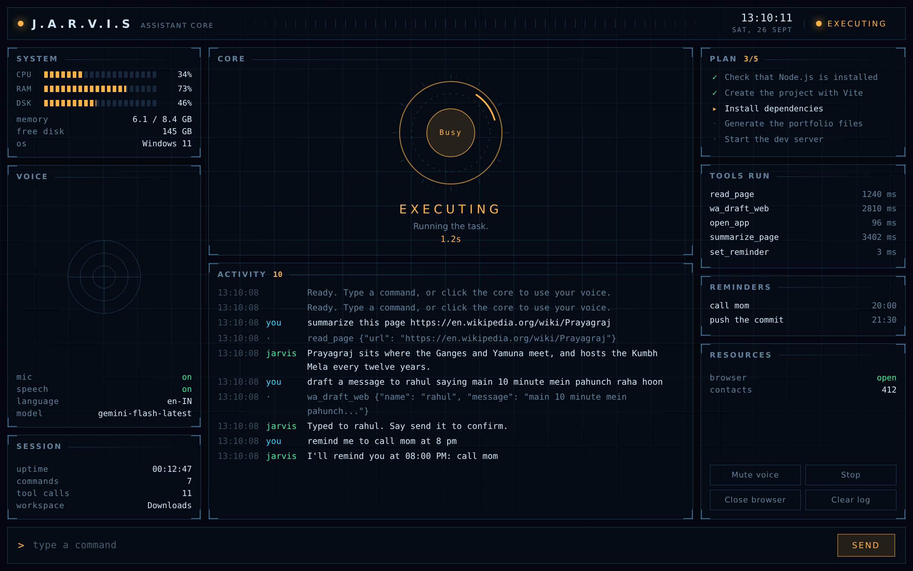

# LITTLE

A small, voice-controlled AI companion for Windows. Say "Little" and then
what you want. It opens applications, manages files, writes and edits code in
VS Code, runs terminal commands, browses and reads web pages, sends WhatsApp
messages, sets reminders, hunts for jobs and reads your screen — and answers
in a sentence or two, with the details on screen.

Little was called JARVIS until recently, and still answers to that name. The
Python package is still `jarvis` and the settings keep their `JARVIS_`
prefix, so nothing already set up had to change.
[LITTLE_IDENTITY.md](LITTLE_IDENTITY.md) covers the persona, the voice and
the wake word, and how to change any of them.

## What makes it different from a wrapper around an API

**Simple commands never reach the model.** A local intent router handles
"open Chrome", "what's the time", "remind me at 8 pm" and about thirty other
patterns in milliseconds, with no network call. The model is reserved for
requests that need thought, which keeps the assistant usable on a free-tier
quota and makes common commands feel instant.

**Nothing destructive happens without a yes.** Every file path is resolved
inside one configured workspace and anything outside it is refused. Deleting,
running shell commands, sending a message, or clicking a button whose label
reads like pay, buy, submit or delete each raise a confirmation the user has
to answer. Overwriting a file keeps a `.bak` copy first.

**Multi-part requests are planned, not improvised.** "Create a React portfolio
and run it" is broken into an ordered list of steps, shown in the Plan panel,
and worked through one at a time with shared context. If a step fails, the run
stops there and says which step and why, instead of continuing through steps
that depended on it.

**Every reading on the panel is real.** CPU, memory and disk come from psutil;
the tool timings are measured; the reminders and contact counts are read from
the store. There is no decorative telemetry.

## Architecture

[ARCHITECTURE.md](ARCHITECTURE.md) has the full, current picture: how a command
travels, the four paths, every module, the threads. In short:

Seven packages, each with one job. Nothing in `tools/` knows the model
exists; nothing in `ai/` knows what a file is. The registry is the only
place the two meet.

    launcher_web.py        opens the window (pywebview); launcher.py is a plain Tk fallback
    ui/                    the window and the job dashboard, plain HTML — no build step
      index.html           the shell: navigation, nine sections, command box
      css/                 the design system: tokens, base, components
      js/core/h.js         the one safe way the page builds anything
      js/core/bridge.js    the one place the page talks to Python
      js/core/router.js    which section shows (#/jobs), focus, window title
      js/core/tasks.js     the task record, as the page knows it
      js/components/       the navigation and the command palette
      js/views/            Home, Chat, Tasks, Jobs, Resume, Projects, Memory, and the ones still to be built
    jarvis/
      app/
        config.py          paths and .env settings, read once at import
        assistant.py       the loop: wake word, routing, speech in and out
        bridge.py          everything the window may ask Python to do
        tasks.py           every command as a task: steps, waiting, reply, how it ended
        stats.py           the live readings the panel shows
        health.py          eighteen probes: what is broken, why, and the fix
      voice/
        listening.py       microphone, room calibration, recogniser
        speaking.py        neural voice, with the local one as fallback
        wake.py            hearing its own name, loosely enough to work
      routing/
        router.py          the fast lane; these commands never reach the model
      ai/
        provider.py        one door to Gemini: retries, fallback, error wording
        brain.py           conversation history and the tool-calling loop
        planner.py         multi-part requests, broken into steps
        prompts.py         Little's persona, and everything it's told about itself
      tools/
        registry.py        the 90 tools and how they are described to the model
        permissions.py     the confirmation gate
        workspace.py       the filesystem fence
        files.py  system.py  apps.py  browser.py
        whatsapp.py  whatsapp_web.py  contacts.py
        reminders.py  screen.py
      store/
        memory.py          profile, preferences, contacts, history
        notes.py           Chat's Save: "Saved from Little.md" in your workspace
      jobs/
        resume.py          a resume (PDF, Word, image) into a candidate profile
        advice.py          the Resume section's four questions for the model
        projects.py        your resume's projects, split into what each line says
        sources.py         public job APIs, and search links for the rest
        matching.py        the 0-100 score, component by component
        store.py           SQLite: jobs, applications, audit trail
        engine.py          the pipeline and what Little says about it
        apply.py           fills a form, never submits one
        dashboard.py       the local dashboard server
    tests/                 no network, sound card or API key needed

Three rules hold the shape:

- A tool module exposes plain functions and imports nothing from `ai/`.
  `registry.py` is where they get names and schemas, so adding a tool
  touches one file.
- Everything that could do damage goes through `permissions.confirm` and
  `workspace.safe_path`. Two functions, two places to audit.
- `provider.py` is the only file that knows the model's HTTP shape, so
  swapping providers is one file, not a search across the codebase.

A command travels: voice → wake word → router → planner or model → tools → speech.

## How it sounds

Little speaks with Microsoft's Indian English neural voice Neerja, lifted a
little in pitch and pace so it sounds young, light and warm rather than
formal — a small companion, not a movie computer. An Indian voice because it
says Indian names the way they're actually said. It needs `edge-tts` and a
network connection; without either it falls back silently to the best
Windows voice installed, preferring the lighter ones.

Spoken replies are kept to a sentence or two. The panel shows everything; the
voice says "Here are your top 10 matches. They're on screen." rather than
reading ten listings aloud.

    what voice are you using

prints the voice, its speed, pitch and volume, and the voices Microsoft
offers right now. Change any of it in `.env`:

    JARVIS_VOICE=en-IN-NeerjaNeural
    JARVIS_VOICE_SPEED=+5%
    JARVIS_VOICE_PITCH=+10Hz
    JARVIS_VOICE_VOLUME=+0%
    JARVIS_VOICE_ENABLED=true

A voice name that doesn't exist doesn't leave it mute: it falls through to
the next voice that works and says so in the log. Setting
`JARVIS_NEURAL_VOICE=false` forces the local engine, which works offline.

## When it mishears you

Every phrase it makes out but doesn't act on is written to the activity log
as `heard: ...`. That one line separates "the mic is dead" from "it hears me
but not my name", which are different problems with different fixes.

"Little", "hey Little" and "ok Little" wake it — but only at the start of
what you say, because "little" is an everyday word. "Wait a little" and "I need
a little help" don't wake it; "Little, open Chrome" does. Its own name needs a
close match ("littl" counts, "title" doesn't); the old name "Jarvis" keeps its
forgiving match, so "jervis" and "javis" still work. Tune the old name's
tolerance with `JARVIS_WAKE_FUZZY`.

    list microphones      the input devices and their numbers
    recalibrate mic       re-learn the room's background noise

If it keeps missing you, in order: run `recalibrate mic`; raise
`JARVIS_PAUSE` to 1.4 if it cuts you off mid-sentence; pick a different
device with `JARVIS_MIC`; and if the room is noisy, set a fixed floor with
`JARVIS_MIC_SENSITIVITY=300` so it stops chasing the noise.

## Job hunter

Little can read your resume, search job boards, score every result against
your actual skills and keep track of what you applied to.

    scan my resume resume.pdf
    set roles to software developer, full stack developer
    set countries to india, worldwide
    set employment type to internship, full-time
    find jobs for me
    show my top matches
    show new jobs           (only what was posted this week)
    why job 1
    which skills am I missing
    open my dashboard

Tracking an application (Chapter 27) — each job moves through found,
analyzed, saved, prepared, applied (your word), submitted (verified), then
interview, offer, rejected or withdrawn. Submitted needs proof: the
confirmation page open in Little's browser, or the confirmation number.

    history of job 1
    verify my application to 1
    mark 1 submitted with confirmation APP-2026-4411
    show my application status

Correcting what the resume scan got wrong or missed, and checking it:

    set my phone to +91 98765 43210
    set my cgpa to 7.8/10
    set my 12th percentage to 85%
    add Docker, AWS to my skills
    remove QuantDesk from my projects
    set my github to github.com/yourname
    check my resume

The scan also reads your degree's CGPA or %, your Class 12 and 10 marks,
achievements and links — each only if the resume's own text contains it.
A posting's academic bar ("CGPA of 7.5 and above", "60% throughout") shows
as a concern on the job when your resume is below it, doesn't state it, or
gives it on another scale; it never changes the score or hides the job, and
CGPA and percentages are never converted into each other. Correcting the
profile re-scores the jobs you already have. A new scan replaces your
corrections with what that resume says, and tells you which.

The dashboard is at **http://localhost:3000/jobs** — job cards with match
scores and skill gaps, an application feed, and analytics showing which
skills keep coming up that your resume doesn't list.

### What a result carries

Every job, from whichever board, is normalised into the same shape: title,
company, location split into city and country, remote / hybrid / on-site,
employment type, seniority, salary when the board gives one, required
skills, the source it came from, its URL, and when it was posted.

Posting age is shown the way it is actually thought about — "posted 3 days
ago", not a date to do arithmetic on — and anything older than 45 days is
marked *likely filled* rather than hidden, because an old posting is still
a real one. A board that sends no date produces a job that says "no date
given". Nothing is ever stamped with today's date to fill the gap; a job
whose age is unknown is never filtered out by a freshness question either,
since not knowing when something was posted is not evidence that it is old.

All six boards are asked at once rather than one after another, so a search
takes about as long as the slowest board instead of the sum of all of them.

Six boards send dates six ways — ISO with a timezone, a unix epoch, RFC-822
out of an RSS feed — and three name the employment type while three leave it
in the prose. Where a board states the type, it is taken at its word; where
it doesn't, the title is read before the description, because "Software
Engineering Intern" is a fact and "our interns love it here" in the blurb
is not. A plain "Software Engineer" is left unlabelled rather than guessed
at mid-level.

### How the score works

It is arithmetic, not an opinion, so "why did you pick this one?" always has
a real answer. Nine dimensions, each scored 0–100 on its own terms and
combined by weight so the total is a percentage of a perfect fit: skills 30,
role 16, seniority 12, experience 12, location 12, employment type 6, work
mode 6, education 4, projects 2. `why job 1` prints every dimension's raw
score and its weighted share, in the shape a MATCH ANALYSIS report should
be — never a claim that a job is suitable, only what lines up and what
doesn't.

A skill you don't have but something close to counts for half, not zero:
Next.js when you know React, Django when you know Python. It is shown as
**partial**, with the actual skill that earned it named — "you have react" —
never a vague "something close."

Alongside the score, **potential concerns** are named outright rather than
buried in a number: a stretch experience bar, a senior-leaning title, a
posting that may already be filled. Set which employment types you want
with `set employment type to internship, full-time`; with nothing set, a
fresher's usual answer is assumed and said so rather than silently guessed.

Three rules override the total, because a high score on a job you cannot
get is worse than no score at all:

- **Out of reach** — a senior title, or a years bar far above you: capped at 45.
- **Out of country** — "remote" usually means remote *within a named set of
  countries*. A listing open only to the USA is capped at 25 for someone in
  Prayagraj. Set yours with `set countries to india, worldwide`; with nothing
  set, the country in your resume's address is used.
- **Out of field** — a posting naming no technology at all, with nothing of
  yours matching, is capped at 30. A search for "software developer" returns
  sales and writing roles, and they should not sit near the top just because
  nothing contradicted them.

### What it will not do

**It does not submit applications.** `prepare application 1` opens the
posting and fills the fields your resume can answer, then stops. You check
the form and press submit. Three reasons: LinkedIn, Naukri and Indeed all
forbid automated submission in their terms; an answer Little guessed would
be a claim made in your name; and an application cannot be taken back.

**It does not invent answers.** Salary expectations, notice period, visa
status, cover letters, demographic questions — Little spots these on the
form and tells you it is leaving them alone.

**It does not scrape.** Jobs come from Adzuna, Jobicy, The Muse, Remotive,
RemoteOK and Arbeitnow, which publish APIs for this. Only Adzuna needs a key,
and it is the one that covers Indian listings properly; the rest work
straight away. `JARVIS_JOB_GEO` and `JARVIS_JOB_CITY` tell the boards that
can filter by place where to look. LinkedIn, Naukri, Indeed and Internshala have no open
API and forbid scraping, so `open linkedin` builds the search URL and opens
it for you to browse yourself.

**It does not record an application you didn't make.** The database only
says APPLIED when you say `mark 1 as applied`.

## Documents

| | |
| --- | --- |
| [INSTALLATION.md](INSTALLATION.md) | installing, upgrading, troubleshooting |
| [ARCHITECTURE.md](ARCHITECTURE.md) | how it's built |
| [API.md](API.md) | the window's bridge, the dashboard, the tools, MCP, the files it writes |
| [SECURITY.md](SECURITY.md) | what it may do, what stops it, what's kept, the last audit |
| [CHANGELOG.md](CHANGELOG.md) | what changed, chapter by chapter |
| [DEMO_SCRIPT.md](DEMO_SCRIPT.md) | the 53-second demo |
| [JARVIS_PHASE2_PLAN.md](JARVIS_PHASE2_PLAN.md) | every chapter in detail |

## Setup

1. Python 3.12 and VS Code with the `code` command on PATH.
2. `py -3.12 -m venv .venv` then `.\.venv\Scripts\Activate.ps1`
3. `pip install -r requirements.txt`
4. `python -m playwright install chromium` — optional; without it the browser
   tools fall back to the Chrome or Edge already installed.
5. Copy `.env.example` to `.env`, add a key from aistudio.google.com, and set
   `JARVIS_WORKSPACE` to the folder Little is allowed to touch.
6. `python launcher_web.py`

For a desktop shortcut: `powershell -ExecutionPolicy Bypass -File make_shortcut.ps1`

### Coming from an old JARVIS folder

Three things live outside the code and are worth bringing across, all from
the old folder into the new one:

| Copy | What it keeps |
| --- | --- |
| `.env` | Your API key and settings — then change the three voice lines, see [LITTLE_IDENTITY.md](LITTLE_IDENTITY.md#upgrading-an-existing-install) |
| `memory/` | Your scanned resume, contacts, preferences and every stored job |
| `browser_profile/` | The WhatsApp Web login, so there's no QR scan again |

Everything else — `.venv`, `jarvis.log`, caches — is made fresh.

## Tests

    pip install -r requirements-dev.txt
    python -m pytest

2912 tests covering the workspace sandbox, the confirmation gate, the intent
router in English and Hinglish, contact-file parsing, the planner's step
sequencing and failure handling, the job match scoring and deduplication,
six boards' worth of date and job-type parsing, the database migration, the
guards that stop an application being recorded that was never made, the
tool registry, the health probes, the wake word, and the panel's safety —
including a replay of an injection that once let text on screen approve a
confirmation by itself — and the window's bridge to Python, the task
record under eight threads at once, real commands replayed from the bridge
into Home and Chat, "Ask again" refusing anything that ran a tool, a plan
stopped partway through the real bridge, job buttons acting on exactly the
card they're on, a new resume scan keeping the preferences you set, the
resume questions refusing to invent, the keyboard route to every section,
the command palette, resume scores read only when the resume states them,
academic bars told apart from salaries and remote-work percentages, every
section at eight window sizes from 1440 px down
to phone width, a name on every control, text as drawn at 4.5:1 or better,
and the dialog holding focus. None of them need a network
connection, a microphone or an API key; the ones that render the panel — the
orb in each state, the layout at several window sizes, keyboard navigation —
skip themselves where no browser is installed.

The tests never touch your own data. They use a temporary memory folder and
log, stop before the first test if they don't, and don't look in your
Downloads, Documents or Desktop. (Before UI-7 they used
the project's `memory` folder and emptied it before every test — so running
them deleted your resume profile, jobs, contacts and memories.)

## Getting around the window

Home is the orb beside what it's doing right now — the command, where the
answer is coming from, each tool step as it runs — with quick actions under
it, anything that needs you (a setup problem, a command that didn't finish,
with Try again), your recent commands and how each ended, and the readings.
The orb shows a brief check when a command finishes and a small "hmm" when
one fails; both come from what actually happened, not from the wording of a
reply.

Chat is the conversation, one turn per command, with the tools each reply
used inside it — open while it runs, folded once it's done. Under each
reply: Copy, Speak (read out again, briefly), Save (into "Saved from
Little.md" in your workspace), Try again for one that didn't finish, and
Ask again for the model's latest plain answer — never one that ran a tool,
so asking again can't do anything twice. "New conversation" makes the model
forget the current one, after a second click.

Tasks lists every command as a task — running, waiting for you, done,
didn't finish, stopped — and shows the one you pick as a timeline of what
actually happened: where the answer came from, the plan if there was one,
each tool with its arguments and timing, any question it asked you and your
answer, and how it ended. "Stop this" asks a running task to stop at its
next step; a command answered on this computer in one go says it can't be
stopped partway, rather than offering a button that couldn't keep its word.
Esc, the Stop button and saying "stop" do the same for whatever is running.
Anything in Home's Recent opens here.

Jobs shows every stored job as a card: the match score and all nine parts
it's made of with their weights, the skills you have, are close on and are
missing, anything worth knowing before applying, how old the posting is and
which board it came from. Search, filter by where you are with it, sort,
and hide postings older than a week. On each card: Open posting, Save,
Prepare application… (opens the posting and fills your name, email, phone
and location — after you say yes, and never submits), and Update status,
where "I applied" also asks first, because only you can say it. Each button
acts on that exact job and shows up as a task. The browser dashboard at
localhost:3000/jobs now uses the same look, and still only reads.

Resume shows what Little read from your resume — name, degree, email, phone
and location (what Prepare application fills in), then skills, education,
projects, experience and certifications, with "Not on your resume" wherever
it didn't say. "Scan a resume…" opens Windows' own file dialog; if a profile
is already there, it asks before replacing it. Your job preferences — roles,
locations, countries, work modes and job types — are edited in place and
saved together, and each says whether it's yours (kept when you scan a new
resume) or came from the resume. Six questions, each run as a task: Analyze,
Improve, Interview prep and Inconsistencies ask Gemini with your resume's
own text and are told never to invent a number, employer or skill; Skill
gaps and Match run on this computer, from the jobs you've found. Answers
also appear in Chat, where you can ask a follow-up. It also shows your CGPA or %,
Class 12 and 10 marks, achievements and links, with "corrected by you"
beside anything you changed by command, and a seventh card, Check resume
health, which runs on this computer.

Projects shows a card per project your resume lists: the name, the line
describing it, the skills from your resume it names, and any link in it —
and, plainly, what a one-line description doesn't say (status, backend,
frontend, database, AI parts). Memory shows what Little keeps about you,
by kind: things you asked it to remember, a summary of your resume and
jobs, your contacts with numbers masked to their last four digits, and the
conversation log. Forget, Remove and Clear delete for real, ask first in
the row, and act on exactly that entry. It also says where all of it lives
and what the model sees: nothing with every request, only what a request
needs.

System shows every setting Little runs with, grouped — AI provider, voice,
microphone, wake word, browser, job search, files — each with its `.env`
key; to change one, edit `.env` and restart. API keys only ever show as set
or missing. From there you can test the voice, see your microphones and
recalibrate, run the health check (and, as its own button, test the model),
see which actions always ask first, your answers to questions this session,
and the job activity trail.

When Little needs your OK, the question says what it wants to do, to what,
the details, and what can't be taken back — "Send a WhatsApp message, to
Rahul (+91 ••••••5678)", the message, "it can't be unsent". Cancel is
focused, Confirm waits a moment, and when there's more than fits, Confirm
waits until you've opened Review. While it's open, the page behind it can't
be clicked or tabbed to, Tab goes round the dialog's own buttons, and
focus goes back where you were once you answer.

Tools lists everything Little can do, grouped by what it works on, each in
the words the model is given, with the five that never run without your
yes marked "Asks first". Search it, or show only those five. Beside the
list is what ran this session — every tool step from the task record, how
long it took and whether it failed — each opening its task. "Check the
tools" runs the same check as saying it, and shows the answer there.

The sidebar holds the other sections — Chat, Tasks, Jobs, Resume, Projects, Memory, Tools and
System.

| Key | Does |
| --- | --- |
| Ctrl+K | Command palette: go to a section, press a control, run a command, or ask anything |
| Alt+1 … Alt+9 | Jump to a section, in sidebar order |
| Ctrl+Space | Start or stop listening |
| Esc | Stop Little: its speech, and whatever it's working on at the next step; in a dialog or the palette, close it instead |

The sidebar shows labels on wide windows and icons on narrower ones; the
arrow at its foot switches, and the choice is kept. On a narrow window it
becomes a bar along the bottom, with More opening the palette. The window
can be made as small as 480 × 560. Between tablet and laptop width, Home
puts the orb and the activity in the wide column with what needs you
beside them and the readings underneath; at phone width it's one column,
in that order. On a touch screen, buttons and fields are at least 44 px
tall.

When a command ends, its reply is also said to a screen reader (briefly,
once). Animations stop when Windows' "Animation effects" is off.

## The demo

Say or type **start the demo** (or press Ctrl+K → Run the demo) for 53
seconds of LITTLE, the same every time: the time answered on this
computer, Hinglish, which tools ask first, a risky command asked through
the real confirmation gate and refused, the audit log of that refusal, and
the measured timings. It needs no internet or model key, reads nothing of
yours and changes nothing; "stop" ends it. `DEMO_SCRIPT.md` is the
presenter's script.

## Commands

Applications: open Chrome, open VS Code, close Spotify, chrome kholo,
spotify band karo.

Browsing: summarize this page https://..., read this page, look up Python
internships in Prayagraj, what's the price on this page, click Sign in,
fill Email with my address, what's on this page, in the browser, find the
internships page on example.com and open the first one. A multi-step task
checks each step on the page before the next, asks before anything that
could submit, send, buy or delete, and never types a password or code.

WhatsApp: open WhatsApp Web, list my contacts, message Rahul saying I'm
reaching in ten minutes, send it. Bulk-load numbers with
`import contacts from contacts.csv`.

Code changes: in the code, fix the add function in calc.py — LITTLE reads the
relevant files, shows the exact small changes and asks once, runs the tests
before and after, and reports; undo the last code change puts it back.

Files and code: create a folder called Projects, find all Python files,
search my project for the login function, summarize this PDF, run the tests
and fix what fails, prepare my project for GitHub. A plan checks each step
against what the tools returned (or the files it should leave), tries a
failed step once more, stops when you say no, and says which steps it
couldn't check rather than calling them done.

Screen: look at my screen, what error is showing, where is the Save button on
screen, click the OK button on my screen. Finding clicks nothing. Clicking
tries LITTLE's own browser by the button's words first; from a screenshot it
clicks only when the model is at least 85% sure, the target couldn't pay,
send, submit or delete, and you say yes.

Resume: show my resume profile, set my cgpa to 7.8/10, add Docker to my
skills, remove Java from my skills, set my address to Lucknow, check my
resume. (`set my location to …` is the job-search preference.)

Your documents: add notes.pdf to my knowledge base, what's in my knowledge
base, search my documents for the deadline, according to my notes, when is the
hackathon deadline? Answers mark what came from your documents as RETRIEVED
FACT with its file and page, and anything the model adds as GENERATED
SUGGESTION. If nothing in them matches, it says so rather than guessing.

Reminders and memory: remind me to call mom at 8 pm, list reminders,
remember that my project folder is D:/dev, remember that my preferred browser
is Firefox, remember for project Blood Bridge that the deadline is Friday,
what do you remember about the deadline, what do you know about project Blood
Bridge, forget my project folder, forget project Blood Bridge. Saying a fact
again updates it. Passwords, codes, PINs, card or ID numbers and keys are
never kept.

Voice: after an answer, a follow-up needs no name for a few seconds ("and
tomorrow?", "close it"). Never mind drops it; stop or cancel stops it;
continue picks a stopped plan up where it stopped. Wake word status,
calibrate the wake word. With pocketsphinx installed
(`pip install -r requirements-optional.txt`), LITTLE checks for its name on this computer first,
so what's said without it never goes to the speech service.

Suggestions: now and then LITTLE mentions one thing from what it already
keeps — new good matches, an application with no answer after a week, a plan
that stopped — at most one an hour and four a day, each once, and it never
acts on them. Any suggestions?, stop suggestions, stop suggesting follow ups,
turn on suggestions.

Tools: what tools do you have, which tools use the browser (or the internet,
the model, files, the screen, messages), which tools require confirmation.

Outside tools (MCP, optional): list MCP servers in memory/mcp_servers.json —

    {"servers": {"notes": {"command": "python", "args": ["notes_server.py"]}}}

— and their tools are offered too, asking before every call unless you set a
tool's "level" lower. Names that suggest paying, passwords, one-time codes or
CAPTCHAs are blocked whatever the file says. What outside tools do you have,
reload outside tools.

Security: security report — every tool's level (safe, low risk, confirm, high
risk, blocked), which keys are set (never their values), the services LITTLE
talks to, your answers and anything that failed or was blocked. Block a tool
outright with JARVIS_BLOCKED_TOOLS in .env.

Models: which model do you use for what. Short jobs (checking a plan step,
summarising a page) use a fast model — JARVIS_MODEL_FAST, default
gemini-flash-lite-latest — and everything else the main one, GEMINI_MODEL.

When something breaks: what went wrong lately. A read-only tool is tried once
more after a passing failure, a closed browser is reopened (and the reply says
so), and with no internet LITTLE says what still works on this computer.

Audit: show me what you did for my last task, show the audit log. Every task
and tool run is kept in memory/audit.jsonl — without keys, passwords, tokens,
messages, what you asked to be remembered or your resume.

At a glance: the System section opens with every part of LITTLE — system,
AI, voice, memory, tools, tasks, browser, jobs, applications, security, logs —
read fresh from real data; "everything at a glance" says it in words.

Self-diagnostics: run a system check, are you okay, check the microphone,
run a full system check, how fast are you (measured times for answers on this
computer, the model and plans).

Benchmarks: benchmark yourself (or run a benchmark, how fast is everything)
times the router, a read-only tool and a search of your documents here —
nothing is sent and nothing opens — and compares with the last run, kept in
memory/benchmarks.jsonl. Benchmark the model too adds one request to each
model tier. In use, every stage is timed: hearing its name, speech to text,
the router, each model tier, each tool run, each browser step, and each
command start to reply.

## Self-diagnostics

Say **run a system check** and Little tests eighteen things about itself:
Python version, project root, `.env`, workspace permissions, every package
in `requirements.txt`, the speech engine, the microphone, a browser it can
drive, the job database, the memory files, free disk, DNS, the tool
registry, every internal import and name, the router's patterns, the dashboard's files, and which job
sources have keys.

Three verdicts, not two. `ok` is working, `warn` is working but degraded —
no Adzuna key, no neural voice — and `FAIL` is broken. Anything that isn't
`ok` is explained three ways, because a check that says FAILED without
naming the fix is a worse version of the traceback it replaced:

    CONFIG — problem
      Problem:  No API key
      Cause:    GEMINI_API_KEY is missing or blank in .env
      Fix:      Get one free at aistudio.google.com and add it, then restart

It takes under a second, because nothing in it reaches the network or starts
anything: the browser probe looks for the executable rather than launching
Chromium, the microphone probe counts devices without opening a stream, and
the model is only called if you say **run a full system check** — that one
costs a request.

For one part on its own: **check the microphone**, **check the browser**,
**check the database**. A probe that itself breaks is reported as a broken
probe rather than taking the report down, so the check still works on the
machine where everything else doesn't.

Two of the probes are there because of a specific kind of bug. Imports written
inside a function don't run until someone says the one command that needs
them, so a refactor can move a module and nothing notices for a week — which
is exactly what happened here: `assistant.py` kept importing `.brain` after
`brain.py` moved to `jarvis/ai/`, and three tools behind the confirmation
gate imported it from a module that no longer existed. The probe reads all
103 of the project's internal imports without running any of them.

The name probe is its other half. A function gets renamed and one caller is
left behind, which Python only discovers when that exact line runs: after
`_query_from` became `_queries_from`, "open linkedin" raised NameError while
every test and every other command passed. It reads compiled bytecode rather
than source, so every name checked is exactly the one the function will
reach for at runtime.

## Configuration

| Variable | Meaning |
| --- | --- |
| `GEMINI_API_KEY` | Key from aistudio.google.com |
| `JARVIS_ASSISTANT_NAME` | What it's called, default `LITTLE`; its name always wakes it |
| `JARVIS_WORKSPACE` | The only folder Little may read or write |
| `GEMINI_MODEL` | Defaults to `gemini-flash-latest` |
| `JARVIS_WAKE` | Extra wake words, comma separated; blank keeps "Jarvis" working |
| `JARVIS_VOICE` | Neural voice, default `en-IN-NeerjaNeural` |
| `JARVIS_VOICE_SPEED` / `_PITCH` / `_VOLUME` | `+5%`, `+10Hz`, `+0%` by default |
| `JARVIS_VOICE_ENABLED` | `false` starts it muted |
| `JARVIS_LANG` | Speech recognition language, default `en-IN` |
| `JARVIS_BROWSER_HEADLESS` | `true` hides the automation browser |
| `ADZUNA_APP_ID` / `ADZUNA_APP_KEY` | Free key from developer.adzuna.com, for Indian listings |
| `JARVIS_JOB_GEO` | Country for boards that filter by region, default `india` |
| `JARVIS_JOB_CITY` | City for boards that filter by city |

Every other setting — the wake word's mode and sensitivity, follow-ups, the
fast model, suggestions and quiet hours, blocked tools, outside tools, where
your data lives — is in `.env.example` with its default and what it does.

## Known limitations

Ctrl+Space works when the window has focus, not system-wide. Speech
recognition needs a network connection, since it uses Google's service.
WhatsApp Desktop sending presses Enter through pyautogui, so the chat window
must stay in front. Job search covers only the boards with public APIs;
LinkedIn, Naukri and Internshala are opened for manual browsing. Resume OCR
for a photographed resume needs Tesseract installed, or falls back to the
model's vision. WhatsApp Web automation depends on that site's markup and
may need its selectors updated. Pages behind a captcha will not load.

## Licence

MIT
